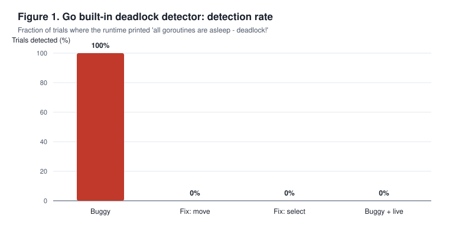
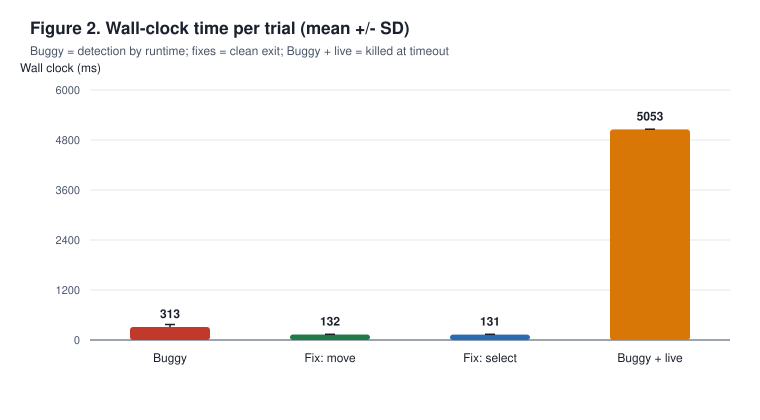
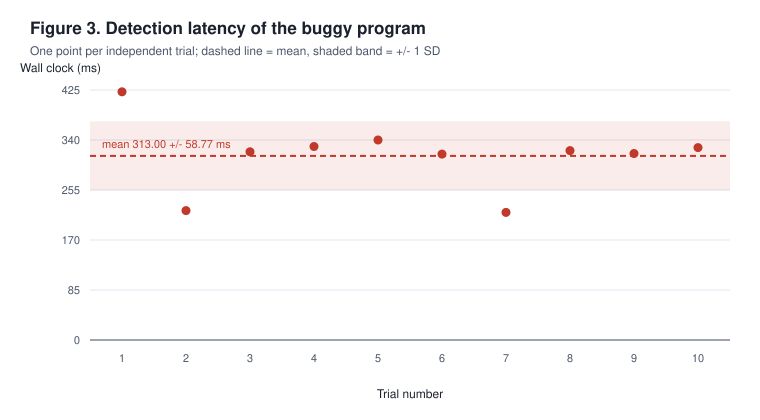

# Reproduction of "Understanding Real-World Concurrency Bugs in Go": A Reduced-Scale Replication of BoltDB#392

**CS340 Operating Systems — Research Paper Replication (Paper 5)**
**Group:** *[fill in group number and members]* &nbsp;&nbsp; **Repository:** *[fill in GitHub URL]*
**Date:** 5 November 2026 &nbsp;&nbsp; **Report source:** `report/report.md`

---

## 1. Introduction and Claims

### 1.1 Paper and problem

Go was designed to make concurrent programming safer by promoting lightweight
goroutines and message passing over channels instead of shared-memory locking.
Tu et al. (ASPLOS'19) [1] test whether that promise holds in real systems. They
manually study 171 fixed concurrency bugs from six widely used Go applications
(Docker, Kubernetes, etcd, CockroachDB, gRPC-Go and BoltDB), classify each bug
along two orthogonal dimensions — behaviour (blocking vs. non-blocking) and
root cause (shared memory vs. message passing) — and evaluate Go's built-in
deadlock and race detectors against the bugs they were able to reproduce.

The systems challenge is twofold: (i) establishing, from historical commits
and bug reports, which concurrency primitive actually causes failures in
practice, and (ii) determining whether the runtime's cheap built-in detectors
are adequate. The paper's answer is negative on both counts: 58% of blocking
bugs are caused by message passing, and the deadlock detector reports only
2 of 21 reproduced blocking bugs. Reproducing this kind of study is
notoriously difficult because it depends on buggy historical revisions,
bug-triggering inputs that are rarely archived, and scheduler behaviour that
changes with the toolchain.

### 1.2 Claims tested

We test three claims, each tied to a specific table or figure of the paper.

- **C1 (Table 8, Section 5.3).** Go's built-in deadlock detector reports only
  2 of the 21 reproduced blocking bugs (9.5%), and explicitly names
  **BoltDB#392** as one of the two. Section 5.3 also states that "the blocking
  can be triggered deterministically in every run". Table 8 breaks the result
  down by root cause: Mutex 7 used / 1 detected, Chan 8 / 0, **Chan w/ 4 / 1**,
  Messaging Libraries 2 / 0.
- **C2 (Table 6, Figure 7, Section 5.1.2).** 16 of 85 blocking bugs belong to
  the "Chan w/" category: one goroutine blocks on a channel operation while
  another blocks on a lock or wait. Figure 7 shows the canonical shape — a
  channel send *inside* a mutex critical section. The course dataset
  (`bug table.xlsx`, sheet `blocking`, row 90) independently labels
  `boltdb#392` as `circular`, `non-traditional`, `message passing`,
  `mixing lock/wait & channel`, `channel in critical section`, with blocked
  primitives `lock` + `channel`.
- **C3 (Table 7, Section 5.2).** Blocking bugs are fixed by small adjustments
  to synchronization primitives (mean patch 6.8 lines); the paper specifically
  mentions "moving a channel operation out of a critical section" and adding a
  `select` with a `default` branch (Figure 7). The dataset records a 2-line
  channel patch (`Syn Remove`, `channel-patch`) for this bug.

### 1.3 Scope

This is an explicitly **reduced-scale** replication, which the assignment
permits if stated. We reproduce **1 of the 21** reproduced blocking bugs
(BoltDB#392) in **1 of 6** applications, with 10 independent trials in each of
four experimental modes (40 trials) plus one supplementary race-detector
check. We do **not** reproduce: the 171-bug taxonomy and lifetime analysis
(Figure 4), the primitive-usage study (Section 3.2, Table 4), the other 20
reproduced blocking bugs and the other detectable case (BoltDB#240), the
non-blocking-bug study (Section 6), or the race-detector evaluation on 20
non-blocking bugs (Section 6.2). All measurements were taken on one machine
with one pinned toolchain; total experiment wall time is about 75 seconds.

## 2. Reproduction Setup

### 2.1 Starting code, commit and modified files

The starting point is the course dataset `go-concurrency-bugs-master`
(upstream: `system-pclub/go-concurrency-bugs` [2]), where row 90 of the
`blocking` sheet identifies `boltdb#392` as a reproduced blocking bug. The
dataset ships the *fix patches*, not a runnable harness, so we rebuilt the
trigger from the original GitHub issue `boltdb/bolt#392` [4] and the Go test
case linked from it [5].

The application under test is `github.com/boltdb/bolt` tag `v1.3.1`, commit
`2f1ce7a837dcb8da3ec595b1dac9d0632f0f99e8` (17 July 2017), vendored verbatim
in `third_party/bolt/` (23 `.go` files, upstream `LICENSE`, and a `go.mod`
containing only a module declaration, since the 2017 code predates Go
modules). **No line of BoltDB's locking logic was changed**; the SHA-256 of
`third_party/bolt/db.go` is recorded in `results/environment.txt`. The files
we added are `go.mod`, `cmd/repro/main.go`, `internal/harness/harness.go`,
`scripts/*`, `Makefile`, `setup.sh`, `Dockerfile`, `docs/*`, `report/*` and
`results/*` (see README.md for the full list).

### 2.2 Environment

All numbers in this report come from: Ubuntu 26.04 LTS on WSL2, kernel
`6.18.33.2-microsoft-standard-WSL2`, 13th Gen Intel i5-13420H (12 logical
CPUs, 7.6 GiB RAM), Go `1.26.8 linux/amd64`, gcc 15.2.0, Python 3.14.4,
git 2.53.0. `GOMAXPROCS` is unset (runtime default 12), `GOTRACEBACK=all`,
`GOPROXY=off`, `GOSUMDB=off` (fully offline build from vendored source).
Versions, the binary checksum and the upstream commit are pinned in
`results/environment.txt` and `docs/ENVIRONMENT.md`; `Dockerfile` pins
`golang:1.26-bookworm`.

### 2.3 Workloads and inputs

BoltDB's `DB.View()` holds `db.mmaplock.RLock()` for the entire read
transaction callback (`beginTx()`, `db.go:466-475`), while a write transaction
that grows the data file calls `db.mmap()`, which needs
`db.mmaplock.Lock()` (`db.go:246`, reached from `allocate()`, `db.go:849`).
The issue's test case starts a long-running `db.View()` on one goroutine and a
`db.Update()` on another, with the reader waiting on a channel for the writer.
Because a remap only happens when the file grows, the original reproduction
is probabilistic; we make it deterministic through the public API only:
`Options.InitialMmapSize = 32768` and a writer that inserts 512 values of
4 KiB (2 MiB), forcing `allocate() -> mmap() -> mmaplock.Lock()` on every run.
No library source is patched.

Each trial creates a fresh database in an OS-provided temporary directory
(`os.MkdirTemp`), so there are no hard-coded paths and no dependence on
previous runs. `scripts/run_experiments.sh` obtains all inputs by script and
records 41 raw logs. Four modes are compared:

| Mode | Difference from the buggy program |
|---|---|
| `buggy` | Reader waits on `<-done` **inside** the `db.View()` callback (the original bug). |
| `move` | Fix from Table 7: channel operations moved **outside** the critical section. |
| `select` | Fix from Figure 7: blocking receive replaced by `select { case <-done: default: }`. |
| `live` | Extension: `buggy` plus one unrelated timer goroutine (Section 5). |

### 2.4 Deviations

**Table 3.** Complete list of deviations from the paper's setup.

| # | Item | Original setting | Setting used | Reason |
|---|---|---|---|---|
| D1 | BoltDB revision | Buggy 2015 version; no commit hash in paper or dataset (`commit hash` column literally reads `boltdb#392`) | `v1.3.1`, commit `2f1ce7a…` (2017), vendored | Assignment requires a pinned commit. The relevant logic is identical: `mmaplock.RLock` in `beginTx` (db.go:475), `mmaplock.Lock` in `db.mmap` (db.go:246), growth path at db.go:849. |
| D2 | Go toolchain | Not reported (paper published 2019) | Go 1.26.8 | Only available toolchain; detector behaviour is re-verified directly. |
| D3 | OS / kernel | Not reported | Ubuntu 26.04 / WSL2 6.18.33.2 | Assignment requires pinned OS and kernel. |
| D4 | Trigger input | Issue test case; remap left to chance | 512 x 4 KiB writes, `InitialMmapSize=32 KiB` | Makes the paper's "deterministic in every run" claim testable. Workload only; library untouched. |
| D5 | Repetitions | 1 per bug | 10 per mode (40 total) | Assignment requires mean +/- SD over >= 3 runs. |
| D6 | Scale | 21 bugs / 6 applications | 1 bug / 1 application | Reduced scale permitted if stated; quantified in Section 4.2. |
| D7 | Metric | Binary detected / not detected | Binary outcome + wall-clock latency + exit code | Enables mean +/- SD and figures; binary outcome stays comparable. |
| D8 | Timeout | Not reported | 5 s (15 s for race check) | Bounds silent hangs; every timeout recorded in `summary.csv`. |
| D9 | Race-detector check | Not applied to this bug in the paper | One `-race` run with `-gcflags=all=-d=checkptr=0` | Controlled check; legacy BoltDB unsafe code fails Go 1.26 `checkptr`. Main build is unmodified. |
| D10 | Build system | Application-native builds | Go modules + local `replace`, `Makefile`, `setup.sh`, `Dockerfile` | Clean-machine build from README alone; no BoltDB `.go` file edited. |

## 3. Results

### 3.1 Comparison with the paper

**Table 1** compares the same metric — the fraction of reproduced blocking
bugs reported by Go's built-in deadlock detector — under the same setting
where applicable. The paper's scope is 21 bugs in six applications; ours is
one bug at reduced scale.

| Metric | Paper (ASPLOS'19) | Ours (reduced scale) |
|---|---|---|
| Reproduced blocking bugs | 21 (6 applications) | 1 (BoltDB#392) |
| Bugs reported by the deadlock detector | 2/21 (9.5%) | 1/1 (100%) |
| BoltDB#392 explicitly listed as detected (Table 8 / Sec. 5.3) | Yes | Yes |
| `Chan w/` category | 1/4 detected (25.0%) | 1/1 detected (100%) |
| Trials of BoltDB#392 | 1 (deterministic, Sec. 5.3) | 10 |
| BoltDB#392 detection rate | 1/1 (100%) | 10/10 (100%) |
| Detection latency | Not reported | 313.00 +/- 58.77 ms |
| Deadlocks after the fix | Not reported | 0/20 (`move`, `select`) |

The key binary result is reproduced exactly: BoltDB#392 is reported by the
runtime, with the expected `fatal error: all goroutines are asleep -
deadlock!` message and exit status 2, in **10/10** independent trials. This is
stronger evidence for determinism than the paper's single run, but it says
nothing about the other 20 bugs (Section 4.2).

### 3.2 Statistics

**Table 2** reports mean +/- sample standard deviation (n-1) over 10
independent trials per mode. Wall-clock time is measured outside the process
with `date +%s%N`, so it includes Go runtime startup.

| Mode | n | Deadlock reported | Silent hang (timeout) | Wall clock (ms), mean +/- SD |
|---|---:|---:|---:|---:|
| Buggy (`buggy`) | 10 | 10/10 (100%) | 0% | 313.00 +/- 58.77 |
| Fix: move (`move`) | 10 | 0/10 (0%) | 0% | 132.40 +/- 3.69 |
| Fix: select (`select`) | 10 | 0/10 (0%) | 0% | 130.80 +/- 5.69 |
| Buggy + live (`live`) | 10 | 0/10 (0%) | 100% | 5053.40 +/- 6.43 |

The `live` value is censored at the 5 s timeout and is a time-to-kill, not a
detection latency.

### 3.3 Visualization

**Figure 1.** The detector fires in every buggy trial and never in the fixed
modes or in the extension mode. The 100% bar for `buggy` is the replication of
the paper's "Yes" for BoltDB#392.

**Figure 2.** Fixed runs terminate in ~131 ms; the buggy run takes ~313 ms
because the runtime must notice that no goroutine can progress; the extension
mode is killed at the timeout.

**Figure 3.** Per-trial latency (220-422 ms). The internal time at which both
goroutines are already blocked is only **8.54 +/- 3.03 ms** (`last_trace_mean_ms`
in `results/statistics.csv`), so about 304 ms of the wall clock is the
runtime detector's own reaction time plus process startup. The SD of 58.77 ms
therefore reflects scheduler/detector jitter, not variance in the workload.

### 3.4 Traceability

`results/summary.csv` is the primary measurement (one row per trial);
`results/raw/` holds all 41 unedited logs; `scripts/analyze.py` derives
`results/statistics.csv`, both numbered tables and all three figures from that
CSV alone; `scripts/make_report.py` builds this PDF. `docs/TRACEABILITY.md`
maps every number in this report to a concrete file, including the checksums
in `results/environment.txt` and the stack trace in
`results/raw/buggy-01.log`.

## 4. Analysis of Discrepancies

### 4.1 Claim verdicts

- **C1 — Supported for the reproduced instance; inconclusive for the
  aggregate rate.** BoltDB#392 is detected in 10/10 runs, exactly as Table 8
  and Section 5.3 state. We cannot confirm the paper-wide 2/21 (9.5%) figure
  because we did not re-run the other 20 bugs; our 100% rate is a *different
  quantity* (one deliberately chosen bug), not a contradictory measurement.
- **C2 — Supported.** `results/raw/buggy-01.log` shows the circular wait
  verbatim: goroutine 1 is in `[chan receive]` at
  `internal/harness/harness.go:168`, called from `bolt.(*DB).View`
  (`db.go:629`), while goroutine 19 is in `[sync.RWMutex.Lock]` at
  `bolt.(*DB).mmap` (`db.go:246`) via `allocate` (`db.go:849`) and
  `Tx.Commit`. One goroutine waits on a channel, the other on a lock — the
  "Chan w/" / mixing-lock-and-channel pattern of Table 6 and Figure 7.
- **C3 — Supported.** Two 2-line fixes (moving the channel wait out of the
  critical section; `select` with `default`) eliminate the deadlock in 0/20
  trials while the workload, library and machine stay identical. This matches
  Table 7's "moving a channel operation out of a critical section" and
  Figure 7's `select`/`default` patch, and the dataset's `patch size = 2`.

### 4.2 Gaps, absolute and relative

| Quantity | Paper | Ours | Absolute gap | Relative gap |
|---|---|---|---|---|
| Detection rate over reproduced bugs | 9.5% (2/21) | 100% (1/1) | +90.5 pp | 10.5x |
| `Chan w/` detection rate | 25.0% (1/4) | 100% (1/1) | +75.0 pp | 4.0x |
| Reproduced blocking bugs covered | 21 | 1 | -20 | 95.2% not covered |
| Applications covered | 6 | 1 | -5 | 83.3% not covered |
| Detection latency | not reported | 313.00 +/- 58.77 ms | n/a | inconclusive |

The first two gaps are **not** evidence against the paper: they are
selection bias caused by the reduced scale. We chose one of the two bugs the
paper says the detector can catch; had we chosen BoltDB#240 or any of the 19
undetected bugs, our rate would differ. We state this explicitly rather than
claiming a 10.5x improvement. The latency gap cannot be quantified because
the paper reports no timing, so its verdict is *inconclusive*. Version
deviations D1-D3 produced no qualitative discrepancy: the same detector
message, the same two blocked primitives and the same fix behaviour were
observed on Go 1.26.8 as the paper describes for its 2019 toolchain.

### 4.3 Evidence from controlled re-runs

1. **Same workload, only the channel placement changes.** All four modes use
   the identical 2 MiB write workload. `move` and `select` (0/20 deadlocks)
   prove the deadlock is caused by waiting on a channel *inside* the read
   transaction, not by mmap growth alone; `buggy` (10/10) is the control.
2. **Single-factor extension (Section 5)** isolates the paper's first stated
   reason for detector failures.
3. **Race-detector check** (`results/race_check.txt`): the same buggy program
   built with `-race` produced **0 data-race warnings** and a silent hang
   (exit 124 after 15 s). This is consistent with a blocking bug rather than
   a shared-memory race (paper Section 6), and it shows that extra runtime
   background activity is enough to suppress the deadlock report. The check
   required `-gcflags=all=-d=checkptr=0` because BoltDB v1.3.1's unsafe
   pointer conversions fail Go 1.26 `checkptr`; this is a toolchain-compatibility
   limitation, not a property of the bug.
4. **Stack-trace evidence** quoted in Section 4.1, reproducible from any
   `results/raw/buggy-*.log`.

### 4.4 Limitations

We re-measured 1 of 21 reproduced blocking bugs, so no claim about the other
20, about BoltDB#240, or about the paper's aggregate detector effectiveness is
supported by our data. Only one Go version, one OS/kernel and one machine
(WSL2 virtualisation) were used; detector timing may differ elsewhere. The
deterministic remap workload is stronger than the original issue's natural
trigger and is a deviation (D4). Wall-clock latency includes process startup
and is detector-dominated; we did not instrument the runtime's `checkdead()`
internals. The `live` measurements are right-censored at 5 s. The race check
needed a non-default compiler flag (D9). Finally, the Dockerfile was not built
on the reporting machine (Docker daemon unavailable); the verified clean-build
path is `./setup.sh && make build && make run` on the pinned Linux environment.

## 5. Extension

### 5.1 Question and motivation

Section 5.3 explains the detector's 2/21 result with two reasons, the first
being that "it does not consider the monitored system as blocking when there
are still some running goroutines", but the paper does not isolate that factor
experimentally. **Question:** for the *same* bug on the *same* machine, does
adding a single unrelated, still-runnable goroutine silence Go's built-in
deadlock detector? This matters because real Go services almost always have
timers, pollers or health-check goroutines — precisely the situation in which
the paper says the detector is ineffective.

### 5.2 Design (one factor changed at a time)

The `live` mode is byte-for-byte the `buggy` harness plus one goroutine that
only ticks a `time.Ticker` every 50 ms. It never touches the database, the
channels or any shared state. Everything else is held constant: same binary
build flags, same workload (512 x 4 KiB, 32 KiB initial mmap), same hardware,
same `GOMAXPROCS=12`, same 5 s timeout, same 10 trials. The only changed
factor is the presence of that unrelated live goroutine.

### 5.3 Result and interpretation

Detection fell from **10/10 (100%)** to **0/10 (0%)**, a -100 percentage-point
effect: every `live` trial hung silently until killed at
5053.40 +/- 6.43 ms, with no `fatal error` in any log
(`results/raw/live-01.log` … `live-10.log`). The race-instrumented check in
Section 4.3(3) independently shows the same failure mode.

This supports the paper's explanation and its **Implication 4**: the built-in
detector is a liveness check on the *whole process*, not a bug detector. One
irrelevant 50 ms ticker is sufficient to make a genuine, fully deadlocked
application look "alive", so the 2/21 detection rate is plausibly an
optimistic upper bound for production systems. It also explains why a
reproduction harness must be minimal: adding a progress printer or a timeout
watchdog to a buggy program can hide the very symptom under study. Relative
to C1, the extension sharpens rather than contradicts the claim — BoltDB#392
is detectable *only* in the unusually quiet process used by the paper's
experiment.

## 6. Conclusion

**Overall verdict: partially reproduced** — the paper's BoltDB#392 claims
(Table 8, Table 6/Figure 7 and Table 7) are fully supported on a reduced scale
of 1 of 21 bugs, while the paper-wide 9.5% detector detection rate, the other
20 bugs and the non-blocking-bug study were not re-measured.

**Lessons learned.** (1) Historical replication lives or dies by version
pinning: the paper and dataset give no commit for this bug, so we pinned
`v1.3.1` and verified that the relevant lock code was unchanged. (2)
Determinism is a property of the workload, not just the bug — forcing the mmap
growth through a public option turned a probabilistic deadlock into a 10/10
reproducible one. (3) Runtime detectors are part of the experimental setup:
an unrelated goroutine or a `-race` build can suppress the deadlock report
entirely. (4) Old code and new toolchains interact (Go 1.26 `checkptr` versus
2017 unsafe pointer code). (5) Reduced-scale replications must quantify their
own selection bias; a 100% detection rate next to the paper's 9.5% is a
statement about scope, not a refutation.

## References

[1] T. Tu, X. Liu, L. Song, and Y. Zhang, "Understanding Real-World
Concurrency Bugs in Go," in *Proc. 24th Int. Conf. Architectural Support for
Programming Languages and Operating Systems (ASPLOS'19)*, 2019.
<https://songlh.github.io/paper/go-study.pdf>

[2] system-pclub, "Data Set for Understanding Real-World Concurrency Bugs in
Go." <https://github.com/system-pclub/go-concurrency-bugs> (course copy:
`go-concurrency-bugs-master`, `bug table.xlsx`, sheet `blocking`, row 90).

[3] boltdb, "bolt: An embedded key/value database for Go," tag `v1.3.1`,
commit `2f1ce7a837dcb8da3ec595b1dac9d0632f0f99e8`.
<https://github.com/boltdb/bolt> (MIT license, copied to
`third_party/bolt/LICENSE`).

[4] "Clarify transaction concurrency," Issue #392, boltdb/bolt, 14 Jun 2015.
<https://github.com/boltdb/bolt/issues/392>

[5] calmh, `boltdb_test.go` test case linked from Issue #392, 14 Jun 2015.
<https://gist.github.com/calmh/8dd3c9548677b12cadc3>

[6] The Go Authors, "Go runtime: deadlock detection (`checkdead`) and the race
detector," Go 1.26.8 source and documentation. <https://go.dev/doc/>

[7] CS340 Operating Systems, "Research Paper Replication" assignment
specification, Academic Year 2026-2027 (claims, report structure, assessment
criteria and Paper List item 5).

## Contribution Statement

*Replace every `TODO` with real values before submission. Each member must
make substantive commits from their own GitHub account, and each commit
message must include the committer's student ID and full name.*

| Member | Student ID | Full name | Substantive contribution |
|---|---|---|---|
| 1 | TODO | TODO | TODO (e.g. literature review, dataset analysis, Sections 1-2) |
| 2 | TODO | TODO | TODO (e.g. harness and Go implementation, `make verify`) |
| 3 | TODO | TODO | TODO (e.g. experiment scripts, statistics and figures) |
| 4 | TODO | TODO | TODO (e.g. extension design, report writing, PDF and GitHub tag `v1.0`) |

## AI Usage Statement

An AI assistant (WorkBuddy, Tencent Hunyuan) was used to read the assignment
specification and the paper, to draft the Go harness, the shell/Python scripts,
the README, the deviation table and the first draft of this report, and to
generate the numbered figures and the PDF from the measured statistics. All
experiments were actually executed on the authors' Linux environment
(WSL2 Ubuntu 26.04, Go 1.26.8) by `scripts/run_experiments.sh`; every number
in this report was computed from `results/summary.csv` and checked against the
unedited raw logs in `results/raw/`. The paper's quoted claims and Table 8
values were verified against the original PDF, and the bug classification was
verified against the course spreadsheet. No AI-generated statement was
accepted without checking it against the source material or the logs. The
authors take full responsibility for the final content, the code and the
interpretation of the results. *[Group members: adjust this statement to match
your actual usage and your institution's policy before submitting.]*
