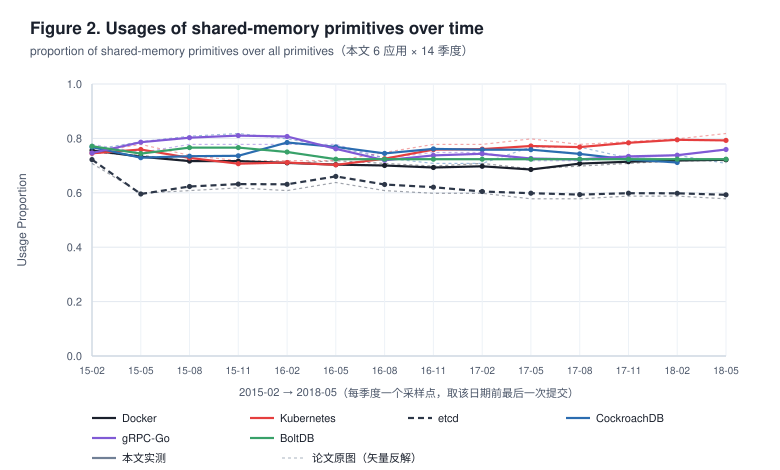
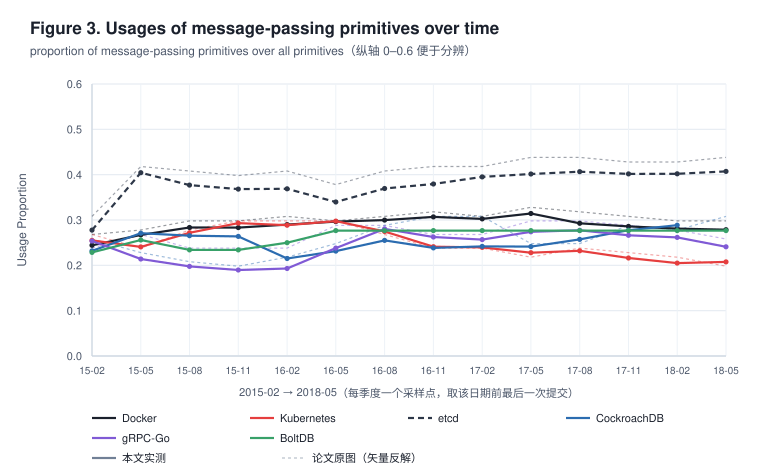

# Figure 2 / Figure 3：并发原语使用比例随时间的变化

论文 §3.2 的最后一句结论是：

> Figures 2 and 3 present the shared-memory and message-passing primitive usages
> in the six applications from Feb 2015 to May 2018. Overall, the usages tend to
> be stable over time, which also implies that our study results will be valuable
> for future Go programmers.

这句话有两个可验证的部分：**水平**（各应用落在什么比例）与**趋势**（是否稳定）。
Table 4 只给了某个快照的比例，时间轴这一维只能自己测。

## 1. 方法

| 项 | 做法 |
|---|---|
| 采样点 | 2015-02-01 … 2018-05-01，每季度一个，共 14 个——正好是论文横轴的 14 个刻度 |
| 取哪个提交 | 该日期之前（含当日）最后一次提交：`git rev-list -1 --before=<date> HEAD` |
| 怎么数 | 同一个 `tools/goast`，与 Table 2/4 完全相同的排除规则（去 `vendor/`、`third_party/`、`*_test.go`） |
| 共享内存 | `lock_calls + atomic + Once + WaitGroup + Cond` |
| 消息传递 | `chan` 收发 + `sync.Pool`（Misc） |
| 比例 | 该类 / 全部原语，与 Table 4 的列定义一致 |

两处必须处理的坑：

**① 2015–2016 的 `Godeps/_workspace` 是 vendor 的前身。** 早期 etcd 把依赖放在
`Godeps/_workspace/src`，k8s 也一样；goast 默认只跳过 `vendor/`，会把上游依赖的
mutex 算进被测项目。第一次跑出来的 etcd 2016-02 有 781 个文件、比例 69.5%，
排除 Godeps 后是 292 个文件、63.1%——差 6 个百分点，趋势也因此变干净。

**② cockroachdb 2018-05 的树里有 Windows 建不出的文件名**
（`pkg/cmd/prereqs/testdata/src/example.com/specialchars/a[]*?~ $%#.go`）。
`git checkout` 直接报 `invalid path`。兜底办法是 `--catfile` 模式：不检出，
用 `ls-tree` + `cat-file --batch` 只把非测试、非 vendor 的 `.go` 取到临时目录。
这个模式还有一个好处：拉不下来的 blob 会被显式跳过，不会静默少数文件。

> crdb 最后一点（2018-05）缺 127/1154 个 blob，partial clone 的 promisor 从
> gitee 取不回来，脚本按"缺一个就整点跳过"处理，所以 crdb 只有 13 个点。

## 2. 结果





实线是本文实测，浅色虚线是从论文 PDF 里反解出来的原图（`extract_fig23.py`，
标定残差 0.00 px，精度约 ±0.02）。纵轴 Fig 2 用 0–1 与论文一致；Fig 3 数据都在
0.2–0.45，改用 0–0.6 才看得出来，横轴刻度不变。

| 应用 | n | 共享内存均值 | 区间 | 首末漂移 | 论文均值 | 逐点平均偏差 |
|---|---:|---:|---|---:|---:|---:|
| Docker | 14 | 71.3% | 68.6–75.6% | −3.4 pp | 71.4% | **0.5 pp** |
| Kubernetes | 14 | 75.1% | 70.3–79.5% | +4.7 pp | 76.4% | **1.4 pp** |
| etcd | 14 | 62.2% | 59.3–72.2% | **−12.9 pp** | 60.7% | **1.5 pp** |
| CockroachDB | 13 | 74.8% | 71.1–78.5% | −5.7 pp | 76.0% | 3.3 pp |
| gRPC-Go | 14 | 75.7% | 72.0–81.0% | +1.3 pp | 75.2% | **1.5 pp** |
| BoltDB | 14 | 73.6% | 72.3–77.1% | −4.8 pp | 论文曲线被覆盖 | — |

消息传递那一侧是同一批数字的补集（Fig 3），逐点偏差 0.7–3.2 pp。

## 3. 与论文的三处对话

**① 水平对得上，这一层是成立的。** 五个能反解的应用，逐点平均偏差 0.5–3.3 个百分点，
相关系数 0.79–0.98（CockroachDB 除外，见③）。这个量级意味着：论文 Fig 2/3 的
纵轴读数可以直接用我们 Table 4 的实测值去对，两边是同一个量。

**② "stable over time" 只对四个应用成立。** 按首末漂移排：

| 应用 | 漂移 | 走势 |
|---|---:|---|
| etcd | **−12.9 pp** | 72.2%（15-02）→ 59.3%（18-05），2016-05 有过一次 3 个点的回升，其余基本单调 |
| CockroachDB | −5.7 pp | 76.8 → 71.1，2016 年有一年高位（78.5） |
| BoltDB | −4.8 pp | 77.1 → 72.3，集中在 2015 年那一段，之后一条直线 |
| Docker | −3.4 pp | 75.6 → 72.2，缓慢下行 |
| Kubernetes | +4.7 pp | 74.5 → 79.3，2016-11 之后明显抬升 |
| gRPC-Go | +1.3 pp | 74.6 → 75.9，真正的"稳定" |

etcd 的 12.9 个百分点不是噪声：它和 etcd 三年里 raft 相关代码大量改用 channel 同步
是同一件事（消息传递占比从 27.8% 升到 40.7%）。论文那句 "tend to be stable"
对 etcd 这种量级的漂移来说偏乐观；至少该写成"除 etcd 外基本稳定"。

**③ CockroachDB 是唯一形状不符的应用。** 逐点平均偏差 3.3 pp、相关系数 0.02，
是我们的六条曲线里唯一跟论文走势对不上的。这与 P2 阶段发现的
"CockroachDB 原语总量 −18.2%、Mutex 少 200、chan 少 211" 是同一件事：
CRDB 大量使用 `syncutil.Mutex` 这类包装类型，机械口径数不准。
它同时也是 Fig 2 里唯一缺一个采样点的应用，两个问题叠在一起，只能标注不吻合。

## 4. 局限

1. **BoltDB 的论文曲线反解不出来**：它的绿线在 PDF 里只留下 x 158→214 的一段
   （其余区间与别的线重合被覆盖），pymupdf 只返回可见段。这一段的值是 0.727，
   与我们 0.723–0.771 的四分位区间重合。
2. **Docker 与 etcd 在图例里都是纯黑**，只能靠末点数值区分（0.718 vs 0.578，
   与 Table 4 的 72.3% / 57.0% 对得上），颜色本身不提供信息。
3. **反解精度 ±0.02**：图只有 121 px 宽，1 px ≈ 0.014 的比例，所以 2 pp 以内的
   差异不该当结论。
4. **crdb 少一点**：原因见 §1 的②，不是漏测，是 blob 拿不到。

## 5. 复现

```bash
# 6 个仓库（3 个本地完整、3 个 gitee 镜像的 blobless 克隆）
python code/analysis/06_evolution.py --out data/evolution_primitive_usage.csv \
    --repo boltdb=... --repo etcd=... --repo grpc-go=...
python code/analysis/06_evolution.py --out data/evolution_primitive_usage.csv --append \
    --repo kubernetes=/tmp/evo/k8s --repo docker=/tmp/evo/moby
python code/analysis/06_evolution.py --out data/evolution_primitive_usage.csv --append --catfile \
    --repo cockroachdb=/tmp/evo/crdb          # Windows 非法路径的兜底

# 论文曲线反解 + 出图
python code/analysis/extract_fig23.py --pdf ../../go-study.pdf --panel 2 --out data/fig2_paper_raw.csv
python code/analysis/extract_fig23.py --pdf ../../go-study.pdf --panel 3 --out data/fig3_paper_raw.csv
python code/analysis/07_fig23.py
```
