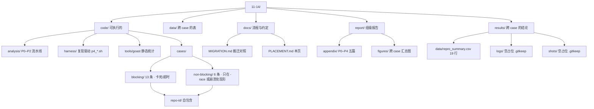
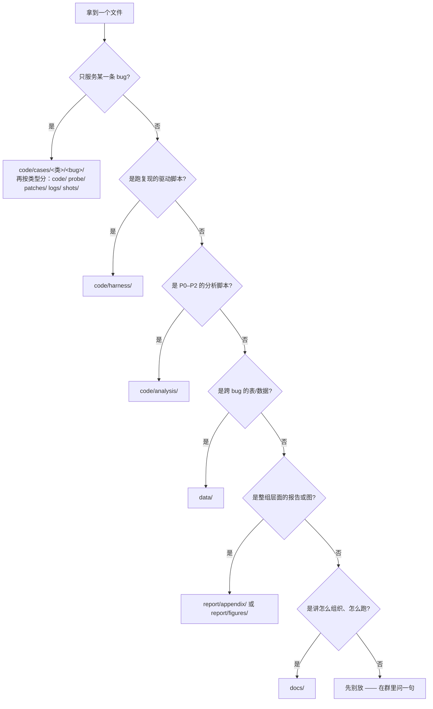

# 路径放置指南 —— 一样东西该放哪儿

> 适用于 `11-14/` 及以后的所有整理版。组员提交前、agent 生成文件前，先对照本页。
> 历史搬迁记录看 [MIGRATION.md](MIGRATION.md)；本页只讲**规则**，不列流水账。

## 四条铁律

1. **一条 bug 一个自包含目录** —— `code/cases/<类>/<repo>-<id>/`。代码、日志、截图、说明全在里面，
   跨目录引用只允许指向 `code/harness/`，不许指向隔壁 case。
2. **通用脚本只留一份** —— 复现驱动在 `code/harness/`，P0–P2 分析在 `code/analysis/`。
   case 里**调用**它们，不复制。改一处就全组生效。
3. **同一结论只写一处** —— 判定口径（`PASS`/`FAIL`/`TIMEOUT`/`NOTRUN`/`ERROR`/`DEADLINE`）的权威描述
   在 `code/harness/README.md`；case 的 README 引用它，不重抄。两处写就会有两套口径。
4. **`data/` 只放能横向比的表** —— 一行 = 一个仓库或一条 bug 的**结论**。一次运行的**明细**留在
   该 bug 自己的 `results/` 里。

## 总图



## 逐目录：放什么 / 不放什么

| 路径 | 放什么 | 不放什么 |
|---|---|---|
| `code/analysis/` | P0–P2 流水线：`01_mine_commits.py`（挖提交）、`02_static_metrics.py`（AST 统计）、`03_compare_paper.py`（与论文比对）、`06_feasibility.py`（可行性筛选）、`07_audit_bug_table.py`（核查）、`check_pins.py`，以及配套 `_paths.sh`、`local.env` | 任何单条 bug 的复现代码 |
| `code/harness/` | 复现驱动：`p4_case.sh`（A 档官方测试）、`p4_probe.sh`（B 档探针）、`p4_deps.sh`、`p4_grpc_logs.sh`、`08_repro_boltdb.sh`、`00_setup_repos.sh`、`00_pin_exact.sh`、`xu_boltdb_*.sh`、`_paths.sh`、`local.env`、`Makefile`、`run.sh` | 某条 bug 专用的补丁、探针（→ 该 case 的 `patches/`、`probe/`） |
| `code/tools/` | `goast/main.go`：Go AST 统计小工具 | 一次性脚本 |
| `code/cases/blocking/` | 卡死 / 超时类，13 条分布在 11 个目录 | non-blocking 的 bug |
| `code/cases/non-blocking/` | 数据竞争 / 中途崩溃类，6 条在 6 个目录 | blocking 的 bug |
| `data/` | `repro_targets.csv`（41 条目标）、`feasibility_44.csv`（44 条可行性）、`bugs_master.csv`、`bug_table_{blocking,non_blocking,application}.csv`、`repo.lock.tsv`（钉版 commit）、`artifact_manifest.csv` | 单条 bug 的 `statistics.csv` / `summary.csv`（→ case 的 `results/`）、任何 `.log` |
| `docs/` | 流程性文档：本页、`MIGRATION.md`、`original-group-README.md` | 报告正文（→ `report/`）、数据表（→ `data/`） |
| `report/` | 组级报告外壳 | 单条 case 的 `report.md`（→ case 内） |
| `report/appendix/` | `p0_repo_pin.md`、`p1_limitation.md`、`p2_static.md`、`p4_feasibility.md`、`p4_repro_boltdb.md`、`xu-1357-report.md` + `xu-1357-summary.csv` | 各 case 的机理分析（→ case README） |
| `report/figures/` | **跨 case** 拼出来的汇总图 | 只用一条 bug 数据的图（→ 该 case 的 `results/figures/`） |
| `results/data/` | `repro_summary.csv`：19 条 bug 的 buggy / fixed 对照总表 | 每次运行的明细 |
| `results/logs/` | **只有 `.gitkeep`** | 任何日志。日志随 case 走 |
| `results/shots/` | **只有 `.gitkeep`** | 任何截图。截图随 case 走 |

> `results/logs/`、`results/shots/` 保留为空是**故意的**：留出位置，但明确告诉你别往这儿放。
> 想找某条 bug 的日志，就去 `code/cases/<类>/<bug>/logs/`。

## 一条 bug 目录的骨架

```
code/cases/blocking/grpc-1459/
├── README.md        必需 · 见下方「六问」
├── run.sh           必需 · 一条命令跑完 buggy 与 fixed 两侧
├── probe/           探针类才有：自写的 *_test.go
│   └── keepalive_awaken_probe_test.go
└── logs/            必需 · 原始输出，按侧与轮次命名
    ├── buggy_iter3.log
    └── fixed_iter3.log
```

四种形态，按被测代码的形态选，不要硬套：

| 形态 | 现有哪些 | 代码放哪 | 运行入口 | 原始输出 |
|---|---|---|---|---|
| 官方测试型 | `grpc-793` `1293` `1424` `1687` `1850` | 不改代码，靠驱动 checkout `fix^` 并只应用补丁里的 `*_test.go` | `run.sh`（`1850` 另有 `run_loop.sh`） | `logs/` |
| 探针型 | `grpc-1459` `grpc-1667` | `probe/*_test.go` | `run.sh` → `p4_probe.sh` | `logs/` |
| 工程型 | `boltdb-392`、`cockroachdb-1cc69980`、`etcd-6873-double-lock`、`etcd-4997`、`kubernetes-62464-20697`、`kubernetes-9926` | 完整 module：`cmd/`、`internal/bugs/`、`go.mod` | `scripts/run_experiments.sh` | `results/raw/` |
| 轻量型 | `boltdb-begin-lock-leak`、`boltdb-341`、`boltdb-7fb06fee`、`moby-17176` | `code/main.go` 单文件 | 见 README 的命令 | `logs/` |

**每个 case 的 README 必须回答六问**，缺一问就不算完成：

1. **症状** —— 看到什么（`fatal error: all goroutines are asleep`、`WARNING: DATA RACE`、超时、panic 位置）
2. **机理** —— 哪一行、为什么；贴关键代码片段，不贴整个文件
3. **修复** —— 修复 commit 与那几行改动
4. **判定口径** —— 什么算命中、什么算没命中；引用 `code/harness/README.md`，不重抄
5. **实测** —— 两侧各跑多少次、各命中几次（写绝对数，不写"基本都能复现"）
6. **怎么重跑** —— Go 版本、`P4_REPO` 之类的环境变量、命令原文

## 拿到一个文件，怎么判断放哪



## 容易纠结的五处

| 纠结 | 判据 |
|---|---|
| 日志放 case 里还是 `results/logs/` | **永远 case 里**。顶层那两个目录是空占位，写了也不算交付 |
| 这份 csv 进 `data/` 还是 `results/data/` | 一行 = 一条 bug 的**结论**、要和别的一起比 → `data/`；19 条的统一对照总表 → `results/data/`；一次运行的明细 → case 的 `results/` |
| 脚本进 `harness/` 还是 case 的 `scripts/` | 换个 bug 编号还能直接跑 → `harness/`；写死了某条 bug 的 commit 或路径 → case 内 |
| 图进 `report/figures/` 还是 case 的 `results/figures/` | 只用一条 bug 的数据 → case；多条 bug 拼一起 → `report/figures/` |
| 说明写 `docs/` 还是 case 的 `README.md` | 讲"这个仓库怎么组织" → `docs/`；讲"这条 bug 怎么回事" → case README |

## 新增一条 bug 的勾选清单

- [ ] 目录名 `{repo}-{id}`，全小写；编号优先取 issue 号，没有 issue 就用短 sha（如 `boltdb-7fb06fee`）
- [ ] 判对侧：卡住 / 超时 → `blocking/`；只有加 `-race` 才报、或中途 panic → `non-blocking/`
- [ ] 先填 README 头部那张表：仓库 / 类型 / buggy commit / 修复 commit / 结论
- [ ] 六问补齐，实测数字写绝对数
- [ ] `run.sh` 在干净环境跑通，两侧结论与 README 数字一致
- [ ] 日志入库，文件名带侧与轮次（`buggy_iter3.log`、`fixed_50x.log`），**不改原文**
- [ ] 截图放 `shots/`，并在 README 里引用
- [ ] `results/data/repro_summary.csv` 加一行
- [ ] `code/cases/README.md` 的表加一行（含负责人）
- [ ] 顶层 `README.md` 的「结果总表」加一行，编号续上
- [ ] 两条 bug 共用一个 module 时别拆开，目录名把两个编号都写全：`etcd-6873-double-lock/`

## 命名规范

| 对象 | 规则 | 例 |
|---|---|---|
| case 目录 | `{repo}-{编号}`，全小写、无空格 | `grpc-1850` |
| 一目录多 bug | `{repo}-{id1}-{id2}` 或 `{repo}-{主题}` | `kubernetes-62464-20697`、`boltdb-begin-lock-leak` |
| 日志 | `{侧}_{轮次}.log` 或 `{侧}-{序号}.log`，跟该 case 既有习惯走，一个 case 内别混用 | `buggy-01.log` |
| 探针 | `{机制}_probe_test.go` | `keepalive_awaken_probe_test.go` |
| 补丁 | `{序号}-{主题}.patch` | `03-begin-lock-leak.patch` |

禁止中文目录名；禁止带空格的大写目录名（见下方例外）。

## 现状例外（照实记着，别当范例）

| 目录 | 现状 | 应改成 | 影响 |
|---|---|---|---|
| `code/cases/blocking/moby-17176/` | `Reproduction code/`、`Screenshot/`、`Source_comparison/` | `code/`、`shots/`、`patches/`（源码对照可留 `source/`） | 带空格、首字母大写，脚本里必须加引号；与其他 case 不一致 |
| `code/cases/blocking/boltdb-392/` | 内含 `docs/`、`report/`、`third_party/`、`Dockerfile`、`Makefile` | 保留（完整工程，拆了就 build 不起来） | case 内 `docs/` 与顶层 `docs/` 同名，引用时写全路径 |
| `code/cases/blocking/grpc-1424/` | 另有 `notes/` | 保留 | 笔记性质，允许 |
| `code/cases/blocking/etcd-6873-double-lock/`、`kubernetes-62464-20697/` | 一个目录两条 bug | 保留 | 共用 `go.mod` 与脚本，拆开两边都跑不起来 |

## 给 agent 的硬约定

```text
# 一条 bug 的落点只有这两条，没有第三处
code/cases/blocking/{repo}-{id}/
code/cases/non-blocking/{repo}-{id}/

# 一条 bug 目录内允许出现的顶层条目（白名单，超出即错）
README.md  run.sh  run_loop.sh
code/  probe/  patches/  logs/  shots/  notes/
cmd/  internal/  scripts/  results/  third_party/
go.mod  Makefile  Dockerfile  .gitignore

# 禁止
- 在 code/cases/ 下新建第 5 个顶层目录
- 往 results/logs/ 或 results/shots/ 写文件
- 在 case 内复制 p4_case.sh / p4_probe.sh（应调用 code/harness/ 中的）
- 把 .log 提交到 data/ 或 docs/
- 新建第二份「结果总表」：只有 results/data/repro_summary.csv 和顶层 README 两张，其余都是引用
```

生成前自查一句话：**如果删掉除了本 case 之外的所有目录，这个 case 还能不能跑起来？**
能，就放对了。
